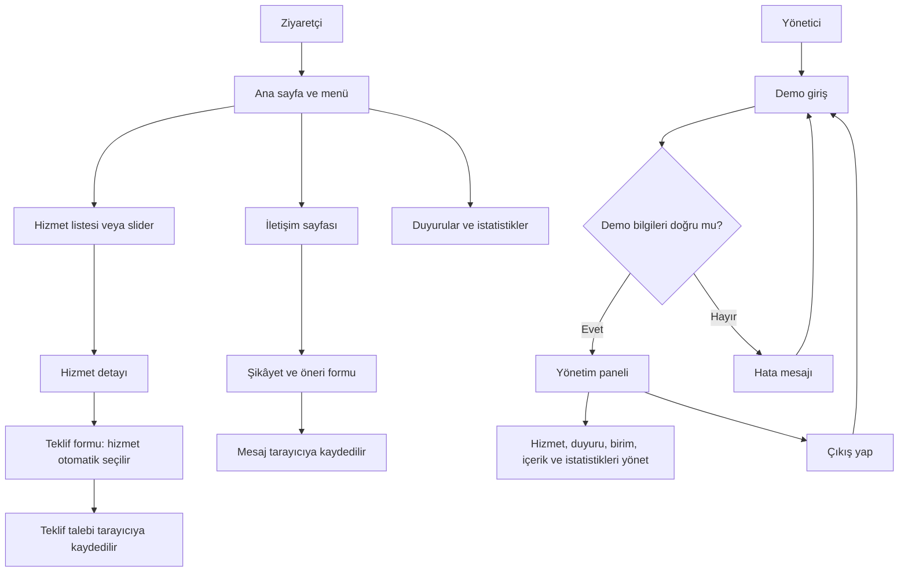
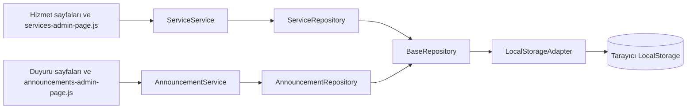

# NovaSoft Ajans

## Proje Hakkında

NovaSoft Ajans, Web Tasarımı dersi kapsamında geliştirilen kurgusal bir dijital ajans sitesidir. Ziyaretçiler hizmetleri ve duyuruları inceleyebilir, istatistikleri görebilir ve iki ayrı iletişim formunu kullanabilir. Yönetim paneli, site içeriklerinin tarayıcı üzerinden düzenlenmesini sağlar.


Ekran görüntüleri: [Ana sayfa](docs/screenshots/ana-sayfa.png), [Ana sayfa duyuruları](docs/screenshots/ana-sayfa-duyurular.png), [Hizmetler](docs/screenshots/hizmetler.png), [Hizmet detayı](docs/screenshots/hizmet-detayi.png), [Duyurular](docs/screenshots/duyurular.png), [Duyuru modalı](docs/screenshots/duyuru-modali.png), [Sayılarla Ajans](docs/screenshots/sayilarla-ajans.png), [İletişim](docs/screenshots/iletisim.png), [Harita](docs/screenshots/harita.png), [Yönetici girişi](docs/screenshots/yonetici-girisi.png), [Yönetim paneli](docs/screenshots/yonetim-paneli.png), [İçerik yönetimi](docs/screenshots/icerik-yonetimi.png) ve [mobil görünüm](docs/screenshots/mobil-gorunum.png).

## Canlı Demo

- [Canlı site](https://bersudemir.github.io/dijital-ajans-web-projesi/)
- [Yönetici girişi](https://bersudemir.github.io/dijital-ajans-web-projesi/admin/giris.html)
- [GitHub deposu](https://github.com/bersudemir/dijital-ajans-web-projesi)

## Kullanılan Teknolojiler

| Teknoloji | Projedeki kullanımı |
| --- | --- |
| HTML5 ve CSS3 | Sayfa yapısı, duyarlı yerleşim ve görsel düzen |
| Bootstrap 5 | Izgara, mobil menü, hizmet slider’ı, modallar ve form bileşenleri |
| JavaScript ES modülleri | Sayfa etkileşimleri, form doğrulama, veri okuma ve yönetim işlemleri |
| Yerel SVG | Ajans ve hizmet illüstrasyonları ile tarayıcıda çizilen grafikler |
| LocalStorage ve SessionStorage | Site kayıtları, form başvuruları ve sekmeye ait giriş işareti |

## Hazır Şablon ve Özelleştirmeler

[Bootstrap Admin / HTML](https://github.com/danilo62x/bootstrap-admin-html) şablonunun bileşenleri ve yönetim paneli yerleşimi kullanıldı. Şablonun `assets/css/app.css` dosyası korundu. Ajansa özgü lacivert giriş ve çağrı bölümleri, kart stilleri ve erişilebilirlik ayarları `assets/css/custom.css` dosyasında yer alır. Ana sayfa illüstrasyonu ve hizmet görselleri depodaki SVG dosyalarından yüklenir.

## Site Sayfaları ve Özellikler

| Sayfa | İçerik |
| --- | --- |
| [Ana Sayfa](index.html) | Ajans tanıtımı, dört gösterge, 5 saniyede ilerleyen hizmet slider’ı ve modalda açılan duyurular |
| [Hakkımızda](hakkimizda.html) ve [Misyon & Vizyon](misyon-vizyon.html) | Ajansın çalışma yaklaşımı, hedefleri ve değerleri |
| [Hizmetler](hizmetler.html) ve [Hizmet Detayı](hizmet-detay.html?slug=web-tasarim-gelistirme) | Aktif hizmetler, kapsam, görsel, başlangıç ücreti ve teklif bağlantısı |
| [Birimler](birimler.html) | Yazılım geliştirme, UI/UX tasarım ve dijital pazarlama ekipleri |
| [Duyurular](duyurular.html) | Yayındaki duyuruların yeniden eskiye sıralanmış listesi |
| [Sayılarla Ajans](sayilarla-ajans.html) | Yıllık proje sayıları, hizmet dağılımı ve müşteri memnuniyetini gösteren SVG grafikler |
| [İletişim](iletisim.html) | İletişim bilgileri, harita ve birbirinden bağımsız iki form |

**Teklif talebi** hizmet detayından açıldığında ilgili aktif hizmeti otomatik seçer. **Şikâyet ve öneri** formu ayrı çalışır. Geçerli başvurular tarayıcının `localStorage` alanına kaydedilir. Alıcı, konu ve mesaj e-posta gönderimine uygun biçimde hazırlanır; gerçek e-posta gönderimi yapılmaz. Kayıtlar yalnızca kullanılan tarayıcıda görülebilir.

## Yönetim Paneli

- **Giriş sayfası** [`admin/giris.html`](admin/giris.html)
- **Demo kullanıcı adı** `admin`
- **Demo şifre** `123`

Demo bilgileri JavaScript kodunda görülebilir. Bu giriş gerçek kimlik doğrulama veya güvenlik sağlamaz. Uygulama giriş bilgilerini saklamaz ve `sessionStorage` alanında yalnızca sekmeye ait oturum işaretini tutar.

Panelde hizmet, duyuru ve birim kayıtları eklenebilir, düzenlenebilir ve silinebilir. Hizmetlerde yerel SVG seçilebilir. Küçük duyuru ekleri (dosya başına en fazla 256 KB) tarayıcıda saklanır ve ziyaretçi sayfalarından indirilebilir. Sayfa İçerikleri ekranı kurumsal metinleri, iletişim bilgilerini ve harita adresini; İstatistikler ekranı ana sayfa göstergelerini ve SVG grafik verilerini günceller. Bu kayıtlar `localStorage` alanında saklanır ve sayfa yenilendiğinde korunur.

## Kurulum ve Çalıştırma

Projeyi klonlayın ve yerel bir HTTP sunucusuyla açın. Örneğin, Python 3 kuruluysa şu komutları kullanabilirsiniz:

```bash
git clone https://github.com/bersudemir/dijital-ajans-web-projesi.git
cd dijital-ajans-web-projesi
python -m http.server 8000
```

[http://localhost:8000/](http://localhost:8000/) adresi ana sayfayı, [http://localhost:8000/admin/giris.html](http://localhost:8000/admin/giris.html) yönetici girişini açar. VS Code Live Server da kullanılabilir. JavaScript modüllerinin yüklenmesi için dosyaları doğrudan açmak yerine HTTP üzerinden çalıştırın.

```text
dijital-ajans-web-projesi/
├── *.html                  Ziyaretçi sayfaları
├── admin/                  Demo giriş ve yönetim ekranları
├── assets/
│   ├── css/                 Şablon ve projeye özel stiller
│   ├── images/              Yerel SVG illüstrasyonlar
│   └── js/app/
│       ├── core/            Başlangıç verileri, kurulum ve depolama bağdaştırıcısı
│       ├── models/          Hizmet ve duyuru veri modelleri
│       ├── pages/           Ziyaretçi ve yönetim ekranı modülleri
│       ├── repositories/    Kayıt okuma ve yazma
│       └── services/        Hizmet ve duyuru kuralları
├── docs/screenshots/        Gerçek site ekran görüntüsü
└── LICENSE                  Şablonun MIT lisansı
```

## Kullanıcı Akış Diyagramı



## Sistem Mimarisi ve Veri Akış Diyagramı

Sayfa modülleri hizmet ve duyuru verilerine ilgili servis üzerinden ulaşır. Servisler, kayıtları repository katmanına iletir. Repository katmanı tarayıcı depolamasına `LocalStorageAdapter` ile erişir. `bootstrap-app.js` bu modülleri birleştirir ve koleksiyon anahtarları henüz yoksa başlangıç verilerini ekler.



### OOP Yapısı

Kod, nesne yönelimli programlamayı (OOP) küçük ve belirli işleri olan sınıflarla uygular:

- **Model (`Service`, `Announcement`)** bir hizmetin veya duyurunun hangi alanları taşıdığını belirler ve kayıt oluşturulurken temel alanları doğrular.
- **Repository (`BaseRepository`, `ServiceRepository`, `AnnouncementRepository`)** kayıtları bulma, kaydetme, silme ve başlangıç verisini ekleme işlerini yürütür. `ServiceRepository` ve `AnnouncementRepository`, ortak işlemleri `BaseRepository` sınıfından devralır; kendilerine özgü sorguları ayrıca tanımlar. Bu, burada kullanılan kalıtım örneğidir.
- **Service (`ServiceService`, `AnnouncementService`)** uygulama kurallarını uygular. Örneğin hizmet adını doğrular, slug üretir ve yalnızca aktif hizmetlerin ziyaretçilere açılmasını sağlar.
- **Page modülleri** sayfadaki HTML öğelerini günceller ve kullanıcı etkileşimlerini ilgili servise iletir. Depolama ayrıntılarını doğrudan yönetmeleri gerekmez.
- **`LocalStorageAdapter`** tarayıcı depolamasına erişimi tek noktada toplar. Anahtar oluşturma ve JSON okuma/yazma işlemlerini kendi içinde tutması kapsüllemeye örnektir.

Bu ayrım, her dosyanın sorumluluğunu anlaşılır kılar. Yeni bir sunucu veya veritabanı eklemez; mevcut tarayıcı tabanlı çalışma biçimini korur.

### Veri Yönetimi

Hizmet ve duyuru kayıtları, `digitalAgency:` önekiyle `localStorage` içinde tutulur; örneğin koleksiyon anahtarları `digitalAgency:services` ve `digitalAgency:announcements` şeklindedir. Sayfa içerikleri, istatistikler, birimler, teklif talepleri ve geri bildirimler de aynı önek altında ayrı kayıtlara yazılır. Yönetici oturum işareti ise `sessionStorage` içindeki `digitalAgency:adminDemoSession` anahtarındadır ve sekme kapanınca sona erer. Bu adlar uygulamanın mevcut veri biçiminin parçasıdır.

Tarayıcı depolamasındaki kayıtlar uygulama tarafından JSON olarak okunur ve yazılır. Koleksiyonlar ilk açılışta yoksa başlangıç verisi eklenir; var olan kayıtların üzerine başlangıç verisi yazılmaz.

## Projenin Sınırlılıkları

- Kayıtlar ve form başvuruları tarayıcıya ve site adresine özeldir. Farklı cihazlar veya tarayıcı profilleri arasında eşitlenmez.
- Demo oturumu istemci tarafında çalışır. Projede sunucu tarafı kimlik doğrulama ve veritabanı bulunmaz.
- İletişimde gösterilen Umuttepe Yerleşkesi konumu eğitim projesi için seçilmiştir; NovaSoft Ajans’ın gerçek ofisi veya üniversiteyle kurumsal bağı olarak değerlendirilmemelidir.
- Formlar alıcı, konu ve mesajı hazırlar ve yerel kayıt oluşturur; e-posta göndermez. Duyuru ekleri küçük dosyalarla ve tarayıcının depolama kotasıyla sınırlıdır.
- Bootstrap JavaScript paketi ve harita gibi dış kaynakların yüklenmesi internet bağlantısına bağlıdır.

## Lisans

Kullanılan [Bootstrap Admin / HTML şablonu](https://github.com/danilo62x/bootstrap-admin-html) MIT lisanslıdır. Orijinal lisans ve telif bildirimi [`LICENSE`](LICENSE) dosyasında yer alır.
