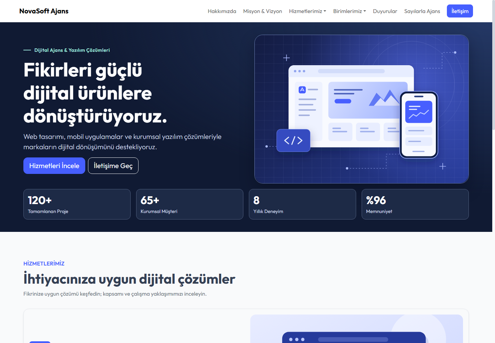
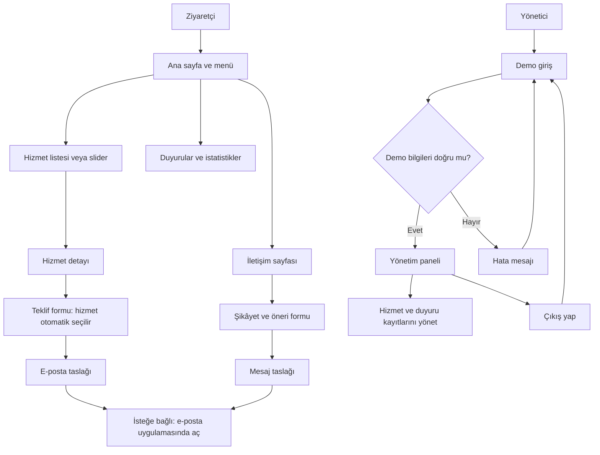
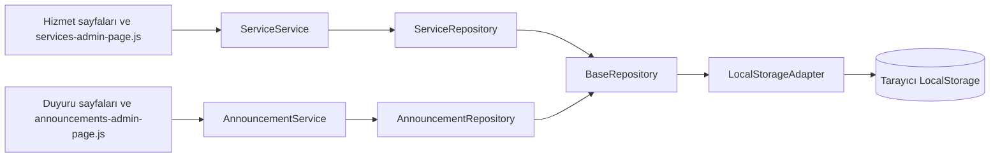

# NovaSoft Ajans

## Proje Hakkında

NovaSoft Ajans, Web Tasarımı dersi kapsamında geliştirilen bir dijital ajans sitesidir. Ziyaretçiler ajansın hizmetlerini ve duyurularını inceleyebilir, istatistikleri görebilir ve iletişim formlarından e-posta taslağı hazırlayabilir. Ayrı yönetim paneli, hizmet ve duyuru kayıtlarının tarayıcı üzerinden düzenlenmesini sağlar.



Ekran görüntüleri: [Hizmetler](docs/screenshots/hizmetler.png), [İletişim](docs/screenshots/iletisim.png), [Yönetici girişi](docs/screenshots/yonetici-girisi.png), [Yönetim paneli](docs/screenshots/yonetim-paneli.png).

## Canlı Demo

- [Canlı site](https://bersudemir.github.io/dijital-ajans-web-projesi/)
- [Yönetici girişi](https://bersudemir.github.io/dijital-ajans-web-projesi/admin/giris.html)
- [GitHub deposu](https://github.com/bersudemir/dijital-ajans-web-projesi)

## Kullanılan Teknolojiler

| Teknoloji | Projedeki kullanımı |
| --- | --- |
| HTML5 ve CSS3 | Sayfa yapısı, duyarlı yerleşim ve görsel düzen |
| Bootstrap 5 | Izgara, mobil menü, hizmet slider’ı, modallar ve form bileşenleri |
| JavaScript ES modülleri | Sayfa etkileşimleri, form doğrulama, veri okuma ve yönetim işlemleri |
| Yerel SVG | Ajans ve hizmet illüstrasyonları ile tarayıcıda çizilen grafikler |
| LocalStorage ve SessionStorage | Hizmet ve duyuru kayıtları ile sekmeye ait demo oturum işareti |

## Hazır Şablon ve Özelleştirmeler

[Bootstrap Admin / HTML](https://github.com/danilo62x/bootstrap-admin-html) şablonunun bileşenleri ve yönetim paneli yerleşimi kullanıldı. Şablonun `assets/css/app.css` dosyası korundu. Ajansa özgü lacivert giriş ve çağrı bölümleri, kart stilleri ve erişilebilirlik ayarları `assets/css/custom.css` dosyasında yer alır. Ana sayfa illüstrasyonu ve hizmet görselleri depodaki SVG dosyalarından yüklenir.

## Site Sayfaları ve Özellikler

| Sayfa | İçerik |
| --- | --- |
| [Ana Sayfa](index.html) | Ajans tanıtımı, dört gösterge, 5 saniyede ilerleyen hizmet slider’ı ve modalda açılan duyurular |
| [Hakkımızda](hakkimizda.html) ve [Misyon & Vizyon](misyon-vizyon.html) | Ajansın çalışma yaklaşımı, hedefleri ve değerleri |
| [Hizmetler](hizmetler.html) ve [Hizmet Detayı](hizmet-detay.html?slug=web-tasarim-gelistirme) | Aktif hizmetler, kapsam, görsel, başlangıç ücreti ve teklif bağlantısı |
| [Birimler](birimler.html) | Yazılım geliştirme, UI/UX tasarım ve dijital pazarlama ekipleri |
| [Duyurular](duyurular.html) | Yayındaki duyuruların yeniden eskiye sıralanmış listesi |
| [Sayılarla Ajans](sayilarla-ajans.html) | Yıllık proje sayıları, hizmet dağılımı ve müşteri memnuniyetini gösteren SVG grafikler |
| [İletişim](iletisim.html) | İletişim bilgileri, harita ve birbirinden bağımsız iki form |

**Teklif talebi** hizmet detayından açıldığında ilgili aktif hizmeti otomatik seçer. Form bir e-posta taslağı hazırlar ve kullanıcının e-posta uygulamasında açmasına olanak verir. **Şikâyet ve öneri** formu ayrı bir taslak hazırlar ve aynı şekilde e-posta uygulamasında açılabilir. İki form da doğrudan e-posta göndermez ve form verisini saklamaz.

## Yönetim Paneli

- **Giriş sayfası** [`admin/giris.html`](admin/giris.html)
- **Demo kullanıcı adı** `admin`
- **Demo şifre** `123`

Demo bilgileri JavaScript kodunda görülebilir. Bu giriş gerçek kimlik doğrulama veya güvenlik sağlamaz. Uygulama giriş bilgilerini saklamaz ve `sessionStorage` alanında yalnızca sekmeye ait oturum işaretini tutar.

Panelde hizmet ve duyuru kayıtları eklenebilir, düzenlenebilir ve silinebilir. Hizmetlerde yerel SVG seçilebilir. Duyuru ekleri için sadece dosya bilgileri tutulur. Yalnızca hizmet ve duyuru kayıtları `localStorage` alanında saklanır. Birimler, Sayfa İçerikleri ve İstatistikler ekranları düzenleme prototipidir ve değişiklikleri kaydetmez.

## Kurulum ve Çalıştırma

Projeyi klonlayın ve yerel bir HTTP sunucusuyla açın. Örneğin, Python 3 kuruluysa şu komutları kullanabilirsiniz:

```bash
git clone https://github.com/bersudemir/dijital-ajans-web-projesi.git
cd dijital-ajans-web-projesi
python -m http.server 8000
```

[http://localhost:8000/](http://localhost:8000/) adresi ana sayfayı, [http://localhost:8000/admin/giris.html](http://localhost:8000/admin/giris.html) yönetici girişini açar. VS Code Live Server da kullanılabilir. JavaScript modüllerinin yüklenmesi için dosyaları doğrudan açmak yerine HTTP üzerinden çalıştırın.

```text
dijital-ajans-web-projesi/
├── *.html                  Ziyaretçi sayfaları
├── admin/                  Demo giriş ve yönetim ekranları
├── assets/
│   ├── css/                 Şablon ve projeye özel stiller
│   ├── images/              Yerel SVG illüstrasyonlar
│   └── js/app/
│       ├── core/            Başlangıç verileri, kurulum ve depolama bağdaştırıcısı
│       ├── models/          Hizmet ve duyuru veri modelleri
│       ├── pages/           Ziyaretçi ve yönetim ekranı modülleri
│       ├── repositories/    Kayıt okuma ve yazma
│       └── services/        Hizmet ve duyuru kuralları
├── docs/screenshots/        Gerçek site ekran görüntüsü
└── LICENSE                  Şablonun MIT lisansı
```

## Kullanıcı Akış Diyagramı



## Sistem Mimarisi ve Veri Akış Diyagramı

Sayfa modülleri hizmet ve duyuru verilerine ilgili servis üzerinden ulaşır. Servisler, kayıtları repository katmanına iletir. Repository katmanı tarayıcı depolamasına `LocalStorageAdapter` ile erişir. `bootstrap-app.js` bu modülleri birleştirir ve koleksiyon anahtarları henüz yoksa başlangıç verilerini ekler.



## Projenin Sınırlılıkları

- Hizmet ve duyuru kayıtları tarayıcıya ve site adresine özeldir. Farklı cihazlar veya tarayıcı profilleri arasında eşitlenmez.
- Demo oturumu istemci tarafında çalışır. Projede sunucu tarafı kimlik doğrulama ve veritabanı bulunmaz.
- Formlar yalnızca taslak hazırlar. Duyuru eklerinin içeriği yüklenmez.
- Bootstrap JavaScript paketi ve harita gibi dış kaynakların yüklenmesi internet bağlantısına bağlıdır.

## Lisans

Kullanılan [Bootstrap Admin / HTML şablonu](https://github.com/danilo62x/bootstrap-admin-html) MIT lisanslıdır. Orijinal lisans ve telif bildirimi [`LICENSE`](LICENSE) dosyasında yer alır.
